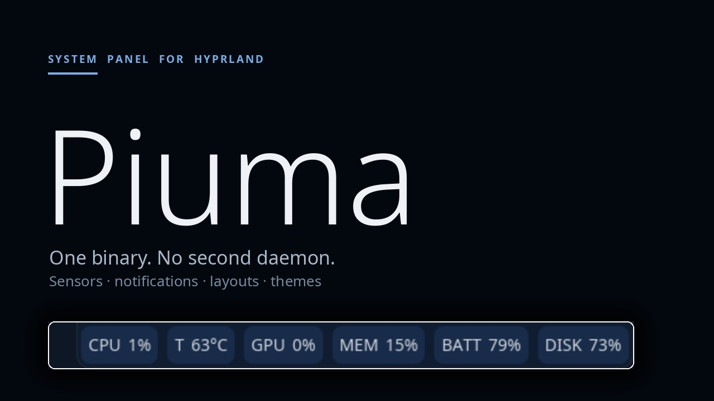

# Piuma — a status bar for Hyprland

<a href="https://youtu.be/0rrx60NHr0M">
  
</a>

[](https://github.com/logicheneurali/piuma/releases)
[](LICENSE)

Piuma is a **lightweight status bar for Hyprland**: sensors, taskbar, system
tray, notifications, media controls, wallpaper and a dashboard in **one Rust
binary**, with a **graphical editor** for its configuration instead of
hand-written JSON.

## Why Piuma

- **One bar binary, no extra daemons** — readings come from `/proc`, `/sys`
  and `hyprctl`; tray, notifications and wallpaper are handled in-process, so
  there is no second service to run or keep in sync.
- **Configure it without JSON** — `piuma-setup` edits the whole bar (sections,
  sensors, colours, wallpaper, autostart, app theme) with a live preview and
  the same validation the bar runs on load, so a mistake is reported before
  it is saved.
- **Everything in the bar** — percentage grids, temperatures, network,
  battery, MPRIS with transport buttons, workspace switcher, taskbar, tray,
  notification server, graphs on hover, a dashboard, a power menu and a
  calendar.
- **Applications follow the bar** — the same palette is projected onto
  GTK 3/4, Qt 6/KDE and a few common apps (kitty, foot, rofi, btop,
  alacritty, mpv, yazi), and restored when the theme is turned off.
- **Hyprland-native** — horizontal or vertical bars, multiple monitors,
  collapsible sections, rounded screen corners, ten built-in colour themes
  and an optional palette extracted from the wallpaper.

## Requirements

- **Hyprland** on Wayland and `hyprctl`.
- A Nerd Font for the icon glyphs (optional, but the defaults assume one).
- To build from source: a Rust toolchain plus the PAM and xkbcommon
  development packages. The prebuilt binary needs their runtime libraries
  (`pam`, `libxkbcommon`) and the usual Wayland graphics stack (a Vulkan or
  OpenGL driver, fontconfig).
- Optional command-line tools only for the sensors that use them (`df`,
  `wpctl`/`pactl`/`amixer`, `nvidia-smi`, `brightnessctl`, …).

## Installation

### Prebuilt binary

1. Download `piuma-<version>-linux-x86_64.tar.gz` and its `.sha256` from
   [Releases](https://github.com/logicheneurali/piuma/releases).
2. Verify and extract it:

   ```sh
   sha256sum -c piuma-<version>-linux-x86_64.tar.gz.sha256
   tar -xzf piuma-<version>-linux-x86_64.tar.gz
   ```

3. Put `piuma` and `piuma-setup` in a directory on your `PATH`:

   ```sh
   install -Dm755 piuma piuma-setup -t ~/.local/bin
   ```

### From source

```sh
git clone https://github.com/logicheneurali/piuma.git
cd piuma
cargo build --release
# or install both binaries directly:
cargo install --git https://github.com/logicheneurali/piuma
```

## Quick start

1. Run the bar:

   ```sh
   piuma
   ```

2. Open the editor:

   ```sh
   piuma-setup
   ```

   You can also right-click an empty area of the bar: it starts the editor
   found next to the bar binary.

3. Configuration lives in `~/.config/piuma/piuma.json` (the active theme in
   `~/.config/piuma/theme.json`). Edits made in `piuma-setup` are hot-reloaded
   by the running bar; adding or removing whole panels needs a restart.
   Another file can be selected with `piuma --config /path/to/piuma.json`.

## Documentation

- [Feature tour](docs/FEATURES.md) — what each part of Piuma does.
- [Configuration reference](docs/CONFIGURATION.md) — every key, sensor and
  tweak, for hand-edited configs.
- [The setup editor](docs/SETUP.md) — the graphical editor in detail.
- [Themes](themes/README.md) — the built-in colour themes and their format.

## Status

Piuma is **0.x software**: it targets Hyprland only, and Waybar remains far
more mature in themes and third-party plugins. Bug reports and feature
requests are welcome in the
[issue tracker](https://github.com/logicheneurali/piuma/issues).

## License

Apache-2.0. See [`LICENSE`](LICENSE); the licenses of the dependencies
compiled into the binaries are in
[`THIRD_PARTY_LICENSES.md`](THIRD_PARTY_LICENSES.md).
