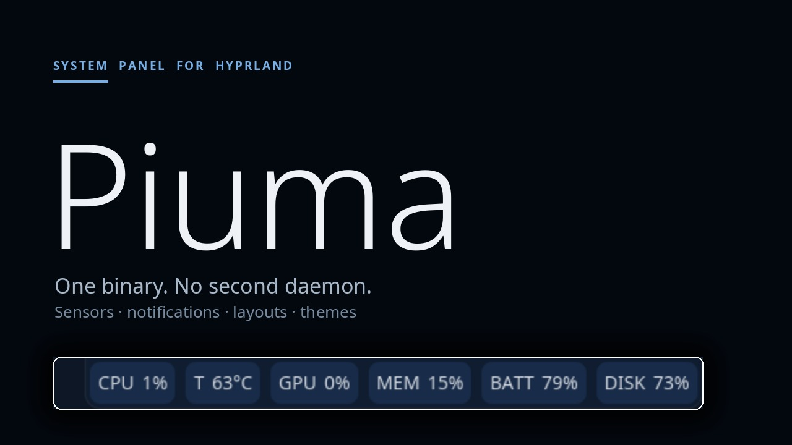

# Piuma - System Information Panel for Hyprland

<a href="https://youtu.be/0rrx60NHr0M">
  
</a>

Piuma is a lightweight system information panel for Hyprland/Wayland.

## Why piuma

Piuma was born from a simple need: a panel that shows what the machine is
doing without turning into a desktop environment of its own.

- **Lightweight**: one Rust binary. Readings come from the files the
  kernel and the drivers already expose (`/proc`, `/sys`) and from
  `hyprctl`; wallpapers, notifications, the tray and the taskbar are
  handled in-process, so there is no second daemon to run.
- **Simple to configure**: every option lives in a single `piuma.json`,
  but nobody has to edit it by hand — `piuma-setup` is the graphical
  front end (sections, sensors, colours, wallpaper palette, autostart,
  app theme) and validates values exactly as the bar does on load, so a
  mistake is reported before it is saved.
- **Minimal requirements**: a Wayland session with a layer-shell
  compositor (Hyprland) and `hyprctl`; every other tool is only needed
  by the sensors that use it. Sensors that cannot read stay silent, and
  the optional features (wallpaper, corners, theme integration) switch
  off cleanly.
- **Applications follow the bar**: the same palette is projected onto
  GTK 3/4 (a complete Adwaita-schema theme), Qt 6 and KDE apps (KDE
  platform theme and `kdeglobals`; Qt 5 keeps its own style), and other
  common apps through their own hooks — kitty, mpv and yazi via an
  environment-selected config directory, foot, rofi, btop and alacritty
  through a marked include. Themes are regenerated when the wallpaper
  palette changes and restored when `app_theme` is switched off or the
  session ends, so a later Plasma/GNOME session is left untouched.

## Features

### Wallpaper

`panel.wallpaper` draws the desktop background in-process. `mode` is
`image` (the default) or `color`: an image uses a cover fit — it fills
each output, keeps its aspect ratio and crops the overhang, so different
aspect ratios crop differently per monitor — while `color` paints a
solid colour. Both are selected in `piuma-setup`'s Wallpaper tab, which
also has a switch for Hyprland's own 8K default wallpaper/logo (it edits
the `misc.disable_hyprland_logo` and `misc.force_default_wallpaper`
values in the Hyprland config and reloads it).

### Themes

Ten colour themes ship inside the binary (no files to install): white on
black, black on white, black on muted orange, white on muted green, cyan
on navy, purple on graphite, lavender on indigo, amber on charcoal, ice
on slate and blue on midnight.
A theme is a colour-only fragment — bar background/text, sensor defaults
and section defaults — applied **over** the user's config in memory;
sections, panels, sensors and layout are untouched, and an explicit
per-sensor or per-section colour still wins.

The active theme is saved in its own file,
`$XDG_CONFIG_HOME/piuma/theme.json` (usually
`~/.config/piuma/theme.json`):

```json
{ "theme": "purple-on-graphite" }
```

**`piuma.json` is never rewritten** by a theme switch: the bar reads
`theme.json` at startup and watches it while running, so picking a theme
in `piuma-setup`'s *Themes* tab or in the `theme` sensor applies it live.
Absent, `null` or an unknown slug means *Custom* — the user's own
colours. A theme suspends `wallpaper_palette` in memory (the wallpaper's
tones would otherwise repaint it); switching back to Custom restores it.

The fragment format (also documented in `themes/README.md`):

```json
{
  "name": "Purple on graphite",
  "panel": {
    "theme_mode": "dark",
    "wallpaper_palette": false,
    "default_bg_color": "#282a36ff",
    "default_text_color": "#f8f8f2ff",
    "sensor_defaults": { "text_color": "#f8f8f2ff", "bg_color": "#44475aff", "...": "..." },
    "section_defaults": { "bg_color": "#21222cff", "...": "..." }
  }
}
```

### Dashboard

The `dashboard` sensor opens a full-screen command center: a dimmed
scrim with a centred two-column card. The header carries the clock and
date plus battery and uptime; the left column has the playing track
with its local cover art, transport, a position bar, the stateful
controls (power profile with the current profile, Caffeine, Bluetooth,
Lock) and the volume slider — brightness too when `brightnessctl` can
write it; the right column shows every numeric sensor as a tile with its
value and sparkline, then the scrollable notification list. Each control
displays its state and updates immediately (the power profile shows the
next profile at once and the real one on the next probe; the volume and
brightness sliders write on release). When the notification list is
empty the sensor tiles stretch to fill the card. A click outside the
card, the ✕ or the sensor again closes it. The probe (MPRIS, profile,
volume, brightness, Bluetooth, network, uptime) and the cover decode run
only while the dashboard is open: a closed dashboard costs nothing — no
polling, no extra D-Bus traffic.

### Sensor Types

Sensor `type` values follow a naming convention by category:

- **`perc_`** – percentage: `perc_cpu`, `perc_gpu`, `perc_mem`, `perc_swap`,
  `perc_disk`, `perc_battery`, `perc_backlight`, `perc_volume`
- **`used_`** – numeric consumption: `used_mem`, `used_swap`, `used_disk`,
  `used_battery`, `used_netdown`, `used_netup`
- **`total_`** – full value: `total_mem`, `total_swap`, `total_disk`,
  `total_battery`
- **`detail_`** – used/total ratio: `detail_mem`, `detail_swap`, `detail_disk`
- **`temp_`** – temperature: `temp_cpu`
- **no prefix** – not numeric: `net_state`, `uptime`, `clock`, `window`,
  `workspace`, `workspace_dots`, `command`, `env_var`, `static_text` (Text/Icon),
  `volume_meter`, `media`, `tray`, `notifications`, `taskbar`, `layout`,
  `lock`, `caffeine`, `power`, `theme`, `dashboard`, `wifi`

The old names (`ProcCpu`, `NvidiaGpu`, `ProcMem`, `ProcDisk`, `Audio`,
`Network`, `Uptime`, `Clock`, `Window`, `Workspace`, `Command`, `EnvVar`,
`StaticText`) are still accepted, so existing configs keep loading;
`piuma-setup` converts them to the canonical names on load, so the next
save writes the new names into `piuma.json`.

### Desktop Notifications

- **Freedesktop server**: with the `panel.notifications` block present,
  piuma claims `org.freedesktop.Notifications` on the session bus — apps
  notify over D-Bus just like with mako/dunst
- **Popup stack**: cards on the overlay layer in the corner opposite the
  bar (icon from `image-data`/`image-path`/`app_icon`, summary and
  markup-stripped body), up to 5 at once; clicking a card runs the
  notification's `default` action and dismisses it, the ✕ only dismisses;
  the card look (font size, colors incl. hover, borders, padding) is
  configurable — white text on black, grey border by default
- **Bar sensor**: the `notifications` source shows the newest active
  summary with a count; the wheel walks the history (`(selected/total)`),
  the click runs the shown entry's `default` action
- **Spec signals**: `NotificationClosed` uses reason 1 (expired),
  2 (dismissed) and 3 (`CloseNotification`); `ActionInvoked` carries the
  invoked action key

### Styling Features

- **Hover Effects**: Color changes on mouse hover
- **Border Styling**: Customizable borders with radius and width
- **Padding Control**: Space around sensor content
- **Section-level Styling**: Background and text colors per section
- **Collapsible sections**: `"collapsible": true` on a section adds a
  clickable dot in the section's own text colour; clicking it collapses
  the section to the dot and back. Runtime state only: the bar starts
  with every section expanded, and a collapsed section's popups close.
- **Rounded Screen Corners**: `panel.screen_corners { enable, color, radius }`
  masks each display corner with a solid-colour square minus the inner
  quarter disk, so the screen itself reads as rounded like the panel —
  drawn on layer-shell overlay surfaces, so it needs a layer-shell
  compositor (Hyprland: works)

### Panel Positioning

- **Anchor Points**: top, bottom, left, right (supports combinations)
- **Alignment Options**: left, center, right (top/bottom on vertical panels)
- **Fill Mode**: `align: "fill"` spreads the sections across the whole panel
  with equal spacers, so the panel always spans 100% of the screen; with
  exactly 3 sections the middle one is kept centered when there is enough
  room (otherwise it falls back to the equal-spacer distribution)
- **Percentage-based filling**: Configure percentage of available space

## Requirements

To build and run Piuma you need:

- **Hyprland on Wayland** — the `window` and `workspace` sensors talk to
  the compositor through `hyprctl`; every other sensor is
  compositor-independent
- **A Rust toolchain** (`cargo`) to build from source — if you don't have
  one, install it from [rustup.rs](https://rustup.rs)
- **A few common command-line tools**, depending on which sensors you
  enable: `df` and `date` (coreutils), a mixer tool for volume
  (`amixer`, `wpctl` or `pactl`) and `nvidia-smi` or AMD sysfs for the
  GPU. All remaining sensors read `/proc` and `/sys` directly and need
  nothing extra — see [Portability](#portability) for the full mapping.

## Installation

1. Clone the repository:

   ```bash
   git clone https://github.com/your-repo/piuma.git
   cd piuma
   ```

2. Build the project:

   ```bash
   cargo build --release
   ```

3. Run Piuma:

   ```bash
   ./target/release/piuma
   ```

## Configuration

Piuma uses JSON configuration files. The default configuration location is:

- `$XDG_CONFIG_HOME/piuma/piuma.json`
- `$HOME/.config/piuma/piuma.json`

Example configuration:

```json
{
  "panel": {
    "font": "Noto Sans",
    "font_size": 12,
    "bold": false,
    "section_layout": "horizontal",
    "default_section_weight": 1,
    "default_bg_color": "#1a1b26",
    "default_text_color": "#e8e8e8",
    "anchor": "bottom",
    "align": "center",
    "percentage": 0.8,
    "section_defaults": {
      "bg_color": "#23232f",
      "text_color": "#c8c8d4",
      "border_color": "#444466",
      "border_width": 1,
      "border_radius": 6,
      "border_type": "full"
    },
    "sections": [
      {
        "name": "System",
        "layout": "horizontal",
        "weight": null,
        "bg_color": "#2d2d3a",
        "text_color": "#ff6b6b",
        "border_color": "#556677",
        "border_width": 2,
        "border_type": "corners",
        "sensors": [
          {
            "name": "CPU",
            "description": "CPU usage percentage",
            "source": { "type": "perc_cpu" },
            "text_color": "#ffaa00",
            "bg_color": "#333333",
            "text_color_hover": "#ffffff",
            "bg_color_hover": "#444444",
            "border_color": "#ff6b6b",
            "border_color_hover": "#ffffff",
            "border_width": 2,
            "border_width_hover": 3,
            "border_radius": 8,
            "padding": 8
          }
        ]
      }
    ]
  }
}
```

`panel.font` is the family of **every** text the bar draws — sensor
names, values and descriptions, section titles, tray tooltips and the
notification popup; `panel.bold: true` renders all of it bold.

A sensor can declare `"icon"`: a freedesktop icon **name** (e.g. `"cpu"`)
drawn before its text, sized to the font and resolved under
`panel.icon_theme` (absent = the system icon-theme setting, then
`hicolor` — the same rule as the tray). Lookups are cached and the whole
icon machinery stays dormant — no theme parsing, no file resolution, no
memory — until at least one sensor declares an icon.

A sensor opts into the panel's value animation with `"effect": true`
(absent = off); `panel.value_effect` above chooses the style.

`panel.value_effect` animates changed values: `underline` fades the
value in and grows a short underline, `sheen` adds a light band sweep.
It is off when absent; only sensors with `"effect": true` animate, so
the global mode is a master switch, not a blanket animation.

`panel.autostart: true` makes the bar launch, once at startup, the
applications marked as autostart under the standard XDG directories —
`$XDG_CONFIG_HOME/autostart` (default `~/.config/autostart`) and the
system `$XDG_CONFIG_DIRS/autostart` (default `/etc/xdg/autostart`) —
following the freedesktop Autostart spec: `Hidden`,
`X-GNOME-Autostart-enabled`, `OnlyShowIn`/`NotShowIn`, `TryExec`,
`Path`, `Exec` field codes, and a user file overriding the system file
with the same name. A program already running is never started twice,
and piuma never launches itself. Absent (the default) the feature is
dormant — nothing is scanned or spawned. The toggle lives in
piuma-setup's *Panel Settings* card.

`panel.theme_mode: "light"` generates the light variant of the bar and
of every theme below; absent (or `"dark"`) keeps the historic dark one.
The light palette is derived from the same seed — the wallpaper palette
when it is active, otherwise the configured colours — with the same hues
and inverted lightness, and the text/selection/cursor tones keep their
WCAG contrast. Explicit per-sensor colour overrides keep their own
colours. The switch lives in piuma-setup's *Panel Settings* card and
applies to the bar without a restart; applications and terminals must be
reopened (or reloaded) to pick up the regenerated themes.

`panel.output` binds the bar to one monitor, by name (`"HDMI-A-2"`);
absent or `"auto"` leaves the compositor's focused output, and `"all"`
mirrors the same bar on every monitor (one surface per output, the main
axis filled to each monitor's size). `all` is the multi-monitor mode:
the same sections are shown everywhere; independent per-monitor content
is not part of this setting. A layer surface cannot move between outputs
at runtime: a change applies at the next piuma start, or with the
**Reload Piuma** button in piuma-setup's footer. The setup's *Panel
Settings* card offers `auto`, `all` and the detected outputs, and notes
the restart requirement.

**Multiple panels.** The root `panels` array holds one layout per bar, each with
its own `output`, `anchor`, `align` and an optional `sections` list of
section names. The section definitions and styles stay global in
`panel.sections`, so the same section/readings can be shown on several
monitors without duplication:

```json
"panels": [
  { "output": "HDMI-A-2", "anchor": "top", "sections": ["Workspace"] },
  { "output": "eDP-1", "anchor": "bottom", "sections": ["Stats"] }
]
```

The anchor also picks the **orientation**: a panel anchored `left` or
`right` is a vertical side bar (thickness wide, stretched between the
top and bottom edges, sensors stacked along the height); `top`/`bottom`
give a horizontal one. The global `panel.section_layout` only decides
the orientation of a panel with **no** anchor (the legacy single-bar
setting) and the `thickness` stays global: a 28 px side bar fits icon
sensors, not long text.

Sections are assigned **exclusively**: the first panel (the legacy
`panel` placement) shows the sections **not** claimed by the later
entries, so adding a secondary panel does not duplicate the main bar. An
explicit first-panel `sections` list overrides that; listing the same
section in two panels is an intentional explicit duplicate. A secondary
panel needs at least one section (validation rejects an empty one). A
file without `panels` keeps the single bar with every section. Windows
are created at startup — changing the number/output of panels needs a
piuma restart. Piuma-setup's *Panel Settings* card lists the extra
panels, their output/anchor/align and their comma-separated section
names; the sections themselves are edited once in *Sections*. Per-panel
copies of the same section (different styles/readings on two monitors)
are not in this version: panels share the section definitions.

`panel.app_theme: true` generates a complete GTK theme at
`~/.local/share/themes/Piuma`: piuma copies the Adwaita stylesheets of the matching `adw-gtk3` variant
(`adw-gtk3-dark` for dark, `adw-gtk3` for light; the widget rules, for
GTK3 and GTK4) and appends its
own palette block, so the theme is self-contained and follows the
Adwaita schema. The block maps the bar's three layers: **windows**
(window, headerbar, sidebar, dialog) use the panel palette,
**containers** (views, lists, cards) the section palette, **interactive
widgets** (buttons, entries, combos, menus) the sensor palette; every
hover uses that layer's hover tone. Translucent tones are flattened
onto the surface behind them so nested GTK widgets cannot blend twice.

GTK loads `~/.config/gtk-{3,4}.0/gtk.css` at USER priority, above any
theme, so piuma also appends the same block to those two files between
`piuma theme begin` / `piuma theme end` markers — otherwise an existing
customisation would keep pinning the old colours. Disabling the toggle
removes the marked block and the theme directory, leaving the rest of
your files untouched.

When `app_theme` is on, piuma injects `GTK_THEME=Piuma`,
`QT_QPA_PLATFORMTHEME=kde` and `QT_STYLE_OVERRIDE=Fusion` into
Hyprland's environment via a marked block in
`~/.config/hypr/hyprland.lua`, followed by a compositor
`reload config-only`, so new applications pick them up automatically.
Qt apps take their palette from the platform theme: the KDE plugin is
the one that reads a configurable palette, and the Fusion style is
needed because Breeze draws its own colours. piuma therefore patches
the `[Colors:*]` groups of `~/.config/kdeglobals` (windows → panel,
views → section, buttons/selection → sensor, disabled text dimmed) and
writes `~/.local/share/color-schemes/Piuma.colors`; the untouched
`kdeglobals` is kept at `<config dir>/theme/kdeglobals.pre-piuma` and
put back, with the scheme file removed, when the toggle goes off.
Applications already running keep their palette until restarted. Qt5
apps fall back to their own style (no KDE platform-theme plugin for
Qt5 is installed); Qt6 apps, including the KDE ones, follow the
palette.

Session exit: logind and systemd stop a session with SIGTERM, which
piuma catches to restore `kdeglobals`, remove the marked block from
`gtk.css`, remove the Hyprland env block and delete the theme and
scheme files. A `loginctl` logout and a normal `reboot`/`poweroff` are
therefore clean: a Plasma or GNOME session started afterwards sees none
of piuma's colours. A forced reboot, a crash or `kill -9` cannot be
caught, but the next piuma start with the toggle off restores the files
anyway. The environment of the running Hyprland session cannot be
un-set without restarting the compositor, so a GTK app launched there
after piuma stopped falls back to the default theme (with a warning).

Other applications. Two mechanisms, both reverted on exit:

- **Environment-selected config dirs** — piuma writes a directory under
  `<config dir>/theme/` and points the app at it, leaving the user's
  files untouched: `KITTY_CONFIG_DIRECTORY` (our `kitty.conf` includes
  yours, then sets colours), `MPV_HOME` (`mpv.conf` includes yours,
  `script-opts/osc.conf` carries the OSC palette; `scripts`, `fonts`,
  `input.conf` and `watch_later` are symlinked), `YAZI_CONFIG_HOME`
  (`theme.toml` generated, your `yazi.toml`/`keymap.toml`/`vfs.toml`
  symlinked).
- **Marked includes in your files** — reverted from the same markers:
  foot (`[colors-dark]` block; foot 1.28 has no top-level include at
  the end), rofi (rules inline in `config.rasi`: a second `@theme` would drop the user theme's structure; font, size (floored at 12px) and weight come from the panel, border width/radius from piuma (collapsed to 0 when the configured border colour is transparent, as the bar has no hover border), and the selected row uses the hover tone), btop (`color_theme = "piuma"` with a
  generated theme file and the previous name restored), alacritty (the
  palette file is added to `[general] import`; the original line is
  kept and put back).

Background, foreground, selection, cursor and accent come from the
three layers; ANSI colours and syntax highlighting are deliberately
left alone so command output and code stay readable.

Numeric style fields — `border_width`, `border_width_hover`, `border_radius`
and `padding` (on sensors, on sections, and on `panel.sensor_defaults` /
`panel.section_defaults`) use the range `-1..=N`:

- `-1` = **disabled**: the item does not override that field; the value
  comes from the panel defaults block (built-in fallback if absent there
  too);
- `0..=N` = **enabled**: a valid value that activates the padding / border /
  radius with that amount;
- a field missing from the config behaves like `-1`.

Sections support the same border drawing as sensors (`border_color`,
`border_width`, `border_radius`, `border_type` = `full`, `corners`,
`underline`, `upperline`, `left`, `right`, `leaf-right`, `leaf-left`;
no hover variants), with the same
precedence rule as `panel.sensor_defaults`: a section owns the border group
only when it sets `border_color`, otherwise the whole group comes from
`panel.section_defaults`. `bg_color`/`text_color` are single keys: the
section value when set, otherwise the defaults, the panel
`default_bg_color`/`default_text_color`, then the built-in ones. A
`border_color` fully transparent (`#rrggbbaa` with alpha `00`) draws no
border at all: the border ring would otherwise punch a transparent
groove through the background.

`panel.section_defaults.respect_screen_edges: true` squares the section
corners that sit flush with a screen edge (roadmap M3): the bar's
anchored side always touches the screen, and on the length axis the
panel ends count as touching when `align` parks a section there
(`fill` = both ends, `left`/`top` = first section, `right`/`bottom` =
last one, `center` = none). Touching sides (corner included) render
square — background and border flush with the screen — only the sides
*away* from the edge keep the rounded corners.

`"collapsible": true` on a section (a toggle in `piuma-setup`'s section
card, written only when on) adds a dot handle at the start of that
section. Clicking the dot collapses the section to the dot alone and
clicking it again expands it; the dot takes the section's text colour,
so it follows the section palette or the active theme. Collapsing closes
that section's graph/calendar popups and clears its hover.

### Sensor sources

Each sensor's `source` object has a `type` plus the parameters listed
(`—` = none). Output examples from a real run:

| `type`           | output                                                       | params                                                                  |
| ---------------- | ------------------------------------------------------------ | ----------------------------------------------------------------------- |
| `perc_cpu`       | CPU usage (`4.8`)                                            | —                                                                       |
| `perc_gpu`       | GPU utilization (`12`; NVIDIA or AMD)                        | —                                                                       |
| `perc_mem`       | RAM used percentage (`45%`)                                  | —                                                                       |
| `perc_swap`      | swap used percentage (`0%`)                                  | —                                                                       |
| `perc_disk`      | root fs used percentage (`66%`)                              | —                                                                       |
| `perc_battery`   | battery charge percentage (`80%`)                            | —                                                                       |
| `perc_backlight` | backlight brightness percentage (`31%`)                      | —                                                                       |
| `perc_volume`    | mixer volume percentage (`50%`)                              | `device` (default `Master`; auto fallback `amixer` → `wpctl` → `pactl`) |
| `volume_meter`   | graphical volume bar: scroll/click, percentage on hover      | `device` (default `Master`)                                             |
| `used_mem`       | RAM used (`14353 MB`)                                        | —                                                                       |
| `used_swap`      | swap used (`0 MB`)                                           | —                                                                       |
| `used_disk`      | root fs used (`619G`)                                        | —                                                                       |
| `used_battery`   | battery energy (`64.0 Wh`)                                   | —                                                                       |
| `used_netdown`   | interface download rate (`   1.6 KB/s`)                      | `interface`                                                             |
| `used_netup`     | interface upload rate (` 66.0 B/s`)                          | `interface`                                                             |
| `total_mem`      | RAM total (`31807 MB`)                                       | —                                                                       |
| `total_swap`     | swap total (`31806 MB`)                                      | —                                                                       |
| `total_disk`     | root fs size (`950G`)                                        | —                                                                       |
| `total_battery`  | full battery energy (`80.0 Wh`)                              | —                                                                       |
| `detail_mem`     | RAM used/total (`14353/31807 MB`)                            | —                                                                       |
| `detail_swap`    | swap used/total (`0/31806 MB`)                               | —                                                                       |
| `detail_disk`    | fs used/total (`619G/950G`)                                  | —                                                                       |
| `temp_cpu`       | CPU package temperature (`65°C`, hwmon `coretemp`/`k10temp`) | —                                                                       |
| `net_state`      | interface state (`connected`)                                | `interface`                                                             |
| `net_info`       | active NetworkManager connection: VPN, Wi-Fi SSID or wired name (`offline` when none) | —                                                     |
| `wifi`           | Wi-Fi state: SSID when online, `no internet` when associated without access, `off` when down; **the icon shows the signal** (excellent ≥75%, good ≥50%, ok ≥25%, weak below) | — |
| `power_profile`  | power-profiles-daemon profile (`Balanced`); click cycles it   | —                                                                       |
| `bluetooth`      | BlueZ adapter (`Off`, `On`, `On (2)` or the connected device); click toggles it | —                                                     |
| `keyboard`       | main keyboard layout (`IT`, `IT CAPS`, `IT NUM`); click switches layout | —                                                              |
| `uptime`         | uptime (`up 2 hours, 30 minutes`)                            | —                                                                       |
| `clock`          | time (`10:12:42`); `format: "date"` = date only              | `format`                                                                |
| `window`         | focused window title (cut at 80 chars + `...`)               | —                                                                       |
| `workspace`      | current workspace                                            | —                                                                       |
| `workspace_dots` | graphical workspace dots: active filled, others outlined     | `count` (default 10, 1–50)                                               |
| `command`        | shell command stdout                                         | `command`, `interval` (s, 0/absent = every tick)                        |
| `list`           | the sensor shows its `name`, or the command's first output line when the name is empty; **hovering** opens the output as a list | `command`, `interval`, `max_lines` (default 10, 1–200) |
| `env_var`        | environment variable value                                   | `env_var`                                                               |
| `static_text`    | text/icon: fixed text, or just the sensor `icon` when the text is empty | `static_text` (optional with an `icon`)                        |
| `media`          | MPRIS player: `⏵  title — artist` (25 chars each); click play/pause, wheel prev/next | —                                                        |
| `tray`           | system tray icons (StatusNotifierItem)                       | —                                                                       |
| `notifications`  | newest active notification (`N6 newest (5)`)                 | —                                                                       |
| `lock`           | lock-screen trigger: shows its name/icon, **clicking locks** every output (password to unlock) | —                                            |
| `caffeine`       | idle-inhibit toggle: shows `on`/`off`, clicking flips it; while on, the idle lock stays away | —                                              |
| `power`          | power menu trigger: **clicking** opens lock / log out / suspend / reboot / shut down | —                                                       |
| `theme`          | active theme's name (`Custom` when none); **clicking** opens the theme picker, the choice is saved in `theme.json` | —                                                       |
| `dashboard`      | dashboard trigger: **clicking** opens the full-screen command center | —                                                       |

`net_info`, `power_profile`, `bluetooth`, `keyboard` and `wifi` are the
runtime-state sensors. `net_info` reads the active NetworkManager
connection (display only; a configured `action` can bind a click, e.g.
`nm-connection-editor`). `wifi` reads the active access point every five
seconds from NetworkManager (signal and SSID) and its connectivity state
(`full` = internet); when NetworkManager is not running it falls back to
**iwd**'s D-Bus API (state, SSID, signal in dBm), which requires the user
to be in iwd's allowed groups (`wheel` or `network`). If the manager
cannot report connectivity, a cached TCP reachability probe decides
`internet` (one attempt every 30 s, 1.5 s timeout). A static `icon` set
on the sensor overrides the signal icon; otherwise the theme's
`network-wireless-signal-*` symbols are used, so the icon theme must
provide them. The other three probe their daemon at most
every five seconds (no fork per tick) and their click controls the
state: `power_profile` cycles balanced → performance → power-saver,
`bluetooth` toggles the adapter, `keyboard` advances the layout (a
configured `action` is ignored there, like on the media sensor). A
command source never runs on the 1 Hz loop: its command runs on its own
thread and the bar shows the last answer meanwhile, so a slow or hung
command (`checkupdates`, network probes, API calls) cannot delay the
other sensors or the clock. With `interval` the answer is reused until
the interval elapses (failures included, no retry storm); the run itself
gets the interval as its time budget, bounded to 5–60 seconds, so a 9 s
whois under `interval: 20` is not killed. The first value appears after
the first run. The `list` source runs its command the same way and keeps
every stdout line for the hover popup (at most `max_lines`, shown in the
same overlay as the icon tooltips); its bar text is the sensor `name`,
or the first line when the name is empty.

A volume or brightness change (from the bar, the media/volume keys or
`wpctl`) shows a small **OSD** card with the new value and a
palette-coloured bar; it sits exactly where the notification popup sits
(same `popup_position` / `popup_margin_h` / `popup_margin_v`, same auto
fallback, same width and reserved-strip handling) and fades after 1.2 s.
Nothing runs while the value is still.

Network rates and the CPU percentage are computed from consecutive
counter samples (`/proc/net/dev`, `/proc/stat`): the very first refresh
can show `N/A` until the second sample arrives. The rate text has a
**fixed composition** (a 4-slot integer part padded with figure spaces
U+2007, one decimal digit, a space, the tier unit) and the sensor pins
its pixel width for the configured font, so a changing value or unit
never makes the sensor box — or its neighbours — resize (roadmap M5).

### System tray

A `tray` sensor renders the freedesktop StatusNotifierItem icons
(nm-applet, kdeconnect-indicator, …) on the bar; while no tray app
registers, the sensor renders nothing at all (no empty box):

```json
{ "name": "Tray", "source": { "type": "tray" } }
```

- **Watcher + host**: piuma speaks the `org.kde` interfaces (with the
  spec-literal `org.freedesktop.StatusNotifierItem` spelling as
  fallback), claims `org.kde.StatusNotifierWatcher` when it is free and
  always registers `org.kde.StatusNotifierHost-<pid>`, so items never
  fall back to the legacy XEmbed tray. When another tray already owns
  the watcher, piuma *observes* it instead — same item list, same
  registration signals — and takes over as soon as that watcher leaves.
- **Interaction**: left click → `Activate`, middle click →
  `SecondaryActivate`, right click → `ContextMenu` (coordinates are
  advisory hints in the spec), wheel → `Scroll` (120 units per notch),
  hover shows the item's tooltip (markup filtered out). Items in
  `NeedsAttention` swap to their attention icon and get a red frame;
  `NewIcon` / `NewStatus` / `NewToolTip` refresh the icon immediately,
  and a dead tray app removes its icon at once.
- **Sizing**: icons scale to the usable height of their sensor box —
  thickness minus section/sensor padding and borders (and the section
  title where sensors stack vertically) — clamped to 4–48px, so they
  fill the sensor and never overflow it.
- **Limitations (v1)**: the legacy XEmbed tray and `OverlayIcon*`
  overlays are not implemented; menus are not rendered host-side — the
  wheel/right-click are forwarded to the item instead (a `dbusmenu`
  host would be needed to draw them); in observer mode registrations
  that carry only an object path (no bus name) cannot be resolved and
  are skipped with a log line.

### Desktop notifications

With the `panel.notifications` block present, piuma claims
`org.freedesktop.Notifications` on the session bus (a freedesktop
notification server like mako/dunst) and pops the notifications up as a
card stack on the overlay layer, in the corner opposite the bar (or
wherever `popup_position` places it):

```json
"notifications": {
  "default_timeout_ms": 5000,
  "history_size": 20,
  "replace_existing": true,
  "popup_position": "auto",
  "popup_margin_h": 8,
  "popup_margin_v": 8,
  "font_size": 12,
  "text_color": "#ffffff", "text_color_hover": "#ffffff",
  "bg_color": "#000000", "bg_color_hover": "#000000",
  "border_color": "#808080", "border_color_hover": "#808080",
  "border_width": 1, "border_radius": 10, "border_type": "full",
  "padding": 12
}
```

The block's **presence** enables the whole feature (no block = server off,
no popup); its keys are optional and fall back to the values above:

- `default_timeout_ms` – fallback expiry when the client passes `-1`;
  `0` and urgency 2 (critical) never expire on their own.
- `history_size` – how many entries the wheel-browsable history keeps
  (the oldest are evicted when it is full; the popup only ever shows
  the newest 5 active ones).
- `replace_existing` – when an app sends an update for the same
  notification, show it on the **existing card** instead of adding a
  duplicate (same id, new content, fresh timer); `false` records every
  call as a new notification instead.
- `popup_position` – where the card stack appears (roadmap M4):
  `auto` (default) keeps the historic layout — the corner opposite the
  bar on the right; the explicit keys are `top-left`, `top-center`,
  `top-right`, `bottom-left`, `bottom-center`, `bottom-right`. Unknown
  values fall back to `auto`.
- `popup_margin_h` / `popup_margin_v` – horizontal and vertical margin
  from the screen edges in px (default `8`), applied to the two sides of
  an explicit `popup_position`.
- The style keys (`font_size`, `text_color[_hover]`, `bg_color[_hover]`,
  `border_color[_hover]`, `border_width`, `border_radius`, `border_type`,
  `padding`) dress the popup cards with the same fields as
  `panel.sensor_defaults` — the defaults are white text on black with a
  grey border, and an absent or `-1` numeric key means "use the
  default". The card height follows font and padding, so the surface
  stays click-exact for any style, and the card's text scrolls inside
  it (wheel) when a long body — or one with line breaks — does not
  fit. All of it is editable in `piuma-setup` under *Desktop
  Notifications*.

```json
{ "name": "Notifiche", "source": { "type": "notifications" } }
```

The `notifications` sensor shows the newest active summary plus
`(selected/total)` while the wheel browses the history, and a left click
runs the shown entry's `default` action. On the popup, clicking a card
does the same (then dismisses the card) and the ✕ only dismisses. The
server emits the spec signals with the right reasons: 1 (expired),
2 (dismissed/closed by user), 3 (`CloseNotification`).

- **Limitations (v1)**: no sounds, no persistence across restarts, no
  do-not-disturb mode; body markup is stripped, actions other than
  `default` are not rendered (the spec's `activationToken` is ignored);
  icons come from `image-data`, `image-path` or the `app_icon` path
  (a themed icon *name* yields no icon).

### Window layouts

A `layout` sensor saves and re-applies the arrangement of the windows
in the current workspace. Everything lives in one file,
`~/.config/piuma/piuma-layouts.json` (next to `piuma.json`): **while
the file is absent the layout system is ignored** — the sensor shows
no value at all — and the **first click creates it** with the current
arrangement.

A **click saves** the visible windows of the workspace you are on.
Layouts are **named automatically** from their (class, workspace) pairs
sorted alphabetically — titles are left out because a terminal follows
its directory and a browser its tab. The same window set always
produces the same name, so saving again replaces that layout instead of
duplicating it; a re-save also folds the title-keyed layouts written by
older versions into the new entry.

The bar **re-applies a saved layout automatically** when a window is
**created, closed, moved to another workspace or floated/re-tiled**: the
activation check runs on those events (never on a timer) — the float
state is part of what a layout describes, so changing it re-evaluates
the match. Matching is by **class**, so a
changed title never blocks a layout. The most specific saved layout
whose classes are all open fires once for that window set; windows of
the same class are paired by float state first (a tiled entry takes the
tiled twin), then by exact title, then by the window already on the
layout's workspace, then by title resemblance, then by position —
so an app with several identical windows still restores. A workspace
move only re-evaluates the match: a layout already applied for the
current window set is **not** applied again, so dragging a window
between workspaces is never undone. An extra window on the layout's own
workspace keeps it unapplied (other workspaces never veto). Moving
windows by hand in between is never fought. When a layout fires right
after an application opens, the window that had the focus is re-focused
once the moves have landed, so the new app does not lose it.

```json
{ "name": "Layout", "source": { "type": "layout" } }
```

(A legacy `"name"` key in the source is ignored: layouts are named by
their window set.)

- **State on the bar**: `⋯` armed and waiting, `✓` applied,
  `✓ saved` right after the click, no value while the file is absent.
- **What is restored**: the workspace of each window and, for a
  floating one, the exact pixel position and size; a tiled one stays in
  the tiler (never floated) and gets its saved **size**, applied
  *measured*: an 8 px probe teaches each edge which
  way it really answers (a bottom window grows by asking up), the
  exact ask follows from that sign, and anything that would push a
  tile under 80 px — or fails to shrink the gap — reverts at once. An
  edge the probe cannot move (a full-width tile's x is the monitor's
  own border) or a tree that cannot hold the saved shape at all (a
  kill + reopen re-inserts the window elsewhere) is left to the
  tiler: no window is ever floated or strangled to force it. A window
  already at the saved size is left untouched. Fullscreen windows get
  no geometry either.
- **The float state is part of the match**: a layout saved with three
  tiled windows does not fit a set where one of them was floated by
  hand — it is not applied at all (nothing half-restored), and the float
  stays. A layout that saved a window *floating* still fits over its
  tiled window and floats it: that is how a floating player is restored
  after its app reopened tiled. Pairing prefers the window that already
  has the saved state, so two windows of the same app never swap it.
- **Matching**: by class *and* window title, with the exact saved
  count — no saved window missing, no extra twin open — and no
  unrelated window on the layout's own workspace either: the layout
  describes that workspace's window set exclusively, so an extra
  window there keeps it unapplied. Windows on other workspaces never
  block it. When **no** saved title fits anymore (a terminal followed
  its directory, a browser its tab), a fallback picks the layout with
  the very same window classes — the same count per class on its own
  workspaces, so the extra-window veto holds by class too — whose
  titles still **resemble** the open ones the most, and only when
  that winner is clear: a tie applies nothing rather than guessing
  between two same-class layouts.
- **Managing layouts**: piuma-setup's **Layouts** tab lists them
  (their windows as `class: title`) and deletes a single one — or all
  of them, which removes the file and turns the system off — both
  behind a confirmation.
- **Limitations**: every `layout` sensor shares the one file and shows
  the same state; layout files edited by hand — or deletions made in
  the setup — reach the running bar on its next restart; monitor
  placement is derived from the saved pixel position only.

### Tweaks

Session settings that patch the compositor at runtime instead of the
bar's own look. They live in `panel.tweaks` and every block is
optional: an absent key changes nothing and costs nothing (no query, no
dispatch).

```json
"tweaks": {
  "dynamic_gaps": { "enabled": true, "min": 4, "max": 16 },
  "window_menu": { "enabled": true, "position": "top-center" },
  "shadows": {
    "enabled": true, "range": 10, "render_power": 1, "sharp": false,
    "color": "#00000099", "color_inactive": "#ffffffff",
    "offset": [0, 0], "scale": 1.0
  },
  "borders": {
    "enabled": true, "size": 1,
    "active": "#ffffff99", "inactive": "#ffffff33"
  },
  "screensaver": { "enabled": true, "minutes": 10 },
  "glass": { "enabled": true, "opacity": 0.35 },
  "auto_hide": { "enabled": true }
}
```

**Screensaver** cuts every output into a grid of 35 rows by 25 columns
whose cells walk the active palette at a pace set by their own
brightness — a white cell finishes a colour cycle in 3 s, a black one
takes 30, and the curve is exponential (`3 · 10^(1 − luma)`), so
mid-tones move faster than a straight line and the screen is mostly
dark — at 5 fps (a light full-surface redraw), after `minutes` of
inactivity (1–120, default 10). It stays off while the focused window is
fullscreen or a video is playing: the sound server's `media.role`
(`pactl`, so PulseAudio and PipeWire alike) marks video/game streams and
leaves music alone, while MPRIS `Playing` is the fallback when no stream
is visible (muted video, bare ALSA, no player role). A windowed video is
therefore never covered either. Any click or pointer movement closes it
(a key press too
when it started from the idle timer, via the compositor's resume event).
It does not lock the session: add hyprlock (and its own listener) if you
want authentication on resume. The idle comes straight from the
compositor (`ext-idle-notify-v1`), so no hypridle is needed. On a v2
compositor it tracks **input** idle and ignores idle inhibitors on
purpose: one client pinning an inhibitor would otherwise disable the
feature for the whole session, and the fullscreen check is what protects
videos and games. `SIGUSR1` shows it at once (the setup's *Show now*
button), and disabling the tweak leaves no idle thread running.

**Dynamic gaps** shrink Hyprland's gaps as more windows open. The gap
to the screen edge (`general:gaps_out`) follows the configured value:
with `min` 4 and `max` 16 it starts at **16** with one window and loses
**25% of the `max - min` range** (3 px) per extra open window:
16 → 13 → 10 → 7 → 4, then it stays at the minimum. The gap between
windows (`general:gaps_in`) is **half** of it (rounded down): 8 → 6 → 5
→ 3 → 2.
The count is every **open window**, not just the active workspace's: the
Hyprland value is global, so a per-workspace count would re-tile every
monitor on every workspace switch. Special workspaces (scratchpads) are
excluded; floating windows count. X11 **popup menus** (Steam's hover
menus, some toolkits') are reported by Hyprland as floating clients with
an empty title: they are not windows and are not counted. Zero windows
keep the maximum.

The bar applies the gap on its 1 Hz tick, only when the count or the
range changed, and always before the layout engine so its measured
resizes start from the new tiling. The value the user's own Hyprland
config had before the first override is captured once and restored when
the tweak is turned **off** and when piuma exits cleanly (both gaps,
per-side values included); a Hyprland
config reload while piuma runs resets the gap and the next window
open/close re-applies it. Without the bar running nothing is applied.

**Window menu** (`window_menu`) is a small floating pill that follows
the focused window with three buttons: close, float (tile ↔ floating)
and sticky (pin across workspaces). `position` is one of `top-left`,
`top-center`, `top-right`, `bottom-left`, `bottom-center`,
`bottom-right`: the menu sits 4 px above or below the window, its left
or right edge flush with the window's own, and drops inside the window
when that spot would leave the output (a maximized or screen-edge window
still gets it). `Sticky` floats a tiled
window before pinning it, since Hyprland only pins floating windows;
unpinning leaves it floating. The icon shows `window-unpin` while the
window is pinned. The menu is drawn with the default sensor's style and
the wallpaper palette, needs no cursor tracking (it is always visible)
and never takes focus, so clicking it leaves the window active. Its
surface reaches the window edge with a transparent 4 px strip (the pill
keeps that gap): the pointer leaves the window straight onto the menu,
so `input:follow_mouse` cannot focus an overlapping window on the way
and the menu no longer moves away before the click. A
hidden fullscreen window has no menu. The toggle and the position apply
on the bar's next 1 Hz tick; while the tweak is off the bar opens no
socket and no surface.

The bar reads the focused window from Hyprland's event socket
(`activewindow`, `movewindow`, `resizewindow`, …) and the geometry from
`j/activewindow` + `j/monitors` on the persistent request socket —
a couple of hundred microseconds per event, no process spawn. The
surface is created once and moved with layer margins; a focus change
glides it for 120 ms (the only frames the menu asks for), a window
dragged under it makes it snap.

**Window shadows** (`shadows`) writes Hyprland's `decoration:shadow`
block: `range` (blur radius, 0-100), `render_power` (blur passes, 1-4),
`sharp` (hard edge instead of a gradient), `color` / `color_inactive`
(`#rrggbbaa`, alpha included, mapped to Hyprland's `rgba()`), `offset`
(`[x, y]` pixels) and `scale` (size multiplier, 0.1-10). The bar writes
the whole block with one `hl.config` call when the values change, only
while the tweak is enabled. The user's own values are read once before
the first override (one `hyprctl getoption` per option) and put back
when the tweak is disabled or piuma exits; a Hyprland config reload
resets them to the file's values until the next piuma start or config
change. The card lives in piuma-setup's *Tweaks* tab.

**Window borders** (`borders`) writes `general:border_size` (0-20 px, 0
removes the border) and `general:col.active_border` /
`general:col.inactive_border` (`#rrggbbaa`). Same contract as the
shadows: one `hl.config` call while the tweak is on, the user's own
values captured before the first override and restored when it is
turned off or piuma exits. On its first use piuma-setup fills the
fields from the values Hyprland is using right now (a gradient
collapses to its first stop), so switching the tweak on changes nothing
until a field is edited.

### Portability

Sensor sources use the smallest practical set of tools:

- **Kernel interfaces only** (`/proc`, `/sys`) — work on any Linux
  distribution, including minimal/busybox systems: `perc_cpu`,
  `perc_mem`/`used_mem`/`total_mem`/`detail_mem`, the `perc_swap`/
  `used_swap`/`total_swap`/`detail_swap` families, `uptime`, `net_state`,
  `used_netdown`/`used_netup`, `temp_cpu` (Intel `coretemp`, AMD
  `k10temp`/`zenpower`), `perc_battery` (battery name is discovered, not
  hardcoded), `perc_backlight`.
- **Base userland** (coreutils — installed everywhere): `perc_disk` and
  the disk families (`df`), `clock` (`date`).
- **Optional tools with automatic fallbacks**: `perc_volume` tries
  `amixer` (ALSA) → `wpctl` (PipeWire) → `pactl` (PulseAudio) and sticks
  to the first that works — and so does the mouse wheel over the sensor,
  which raises/lowers the volume by 5% per notch (clamped 0–100%);
  `volume_meter` uses the same backend and offers a clickable bar;
  `perc_gpu` tries
  `nvidia-smi` (NVIDIA) → the
  amdgpu sysfs counter (AMD), `N/A` on other GPUs.
- **Hyprland** (`hyprctl`): `window`, `workspace` — the only
  compositor-specific sensors, by design.
- **Yours**: `command` (any POSIX shell), `env_var`, `static_text` (Text/Icon).

## Usage

1. Run with default config:

   ```bash
   ./target/release/piuma
   ```

2. Run with custom config:

   ```bash
   ./target/release/piuma --config /path/to/config.json
   ```

## Configuration GUI Tool

For a visual configuration tool, you can use:

1. The `piuma-setup` binary (if compiled)
2. Or use the command-line configuration wizard
3. Or manually edit the configuration file

The running bar opens `piuma-setup` with a **right-click** anywhere it
has no widget of its own: tray icons and taskbar slots keep their own
right-click menus, every other zone starts the editor found next to the
bar binary.

`piuma-setup` loads `~/.config/piuma/piuma.json` on startup. The
categories sit behind **side tabs** on the left — Panel, Section
Defaults, Sensor Defaults, Sections, Wallpaper, Themes, Notifications,
Autostart apps, Layouts, Tweaks — and only the selected
category's card is shown, so the growing configuration stays readable;
unsaved edits live in memory, so switching tabs never loses work. The
bottom bar offers:

- **Load…** – edit any `*.json` file from `~/.config/piuma/` (different styles
  can live side by side);
- **Save** – writes the file being edited, asking for confirmation when there
  are unsaved changes;
- **Save As…** – saves under a new name, with an extra confirmation if the
  file already exists;
- **Reset** – restores the default configuration.

Each section and sensor header also shows **▲/▼** buttons that move it
up/down in the panel order (the arrow is disabled on the first/last item).

## License

Apache-2.0. The licenses of every dependency compiled into the Linux
binaries are listed in [THIRD_PARTY_LICENSES.md](THIRD_PARTY_LICENSES.md),
together with the copyright notices and full license texts a binary
distribution must carry; the MPL-2.0 text applying to `option-ext` is
also in [LICENSES/MPL-2.0.txt](LICENSES/MPL-2.0.txt).

The file is regenerated from the resolved Cargo graph when dependencies
change. Any binary or archive distribution must ship `LICENSE`,
`THIRD_PARTY_LICENSES.md` and the `LICENSES/` directory alongside the
executables.